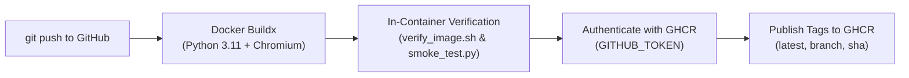

# Playwright Python Chromium Docker Image (GitHub Actions & GHCR)

A dedicated, lightweight container image optimized for running **Playwright Python** and **Behave BDD** test suites inside **GitHub Actions**.

The image is automatically built, verified, and published directly to **GitHub Container Registry (GHCR)**:
```text
ghcr.io/<owner>/<repository>:latest
```

> [!NOTE]
> **Zero Local Docker Required**: You do not need Docker installed on your computer. GitHub Actions builds, tests, and publishes this container entirely in the cloud on every push.

---

## 📦 Image Contents

- **Base System**: Ubuntu Jammy (from `mcr.microsoft.com/playwright/python:v1.40.0-jammy`)
- **Python**: Python 3.11 with `pip` pre-upgraded
- **Pre-installed Test Dependencies** (from [`requirements.txt`](requirements.txt)):
  - `playwright` (`>=1.40.0,<1.41.0`)
  - `behave` (`~=1.3.3`), `parse`, `parse-type`
  - `pydantic` (`~=2.10`), `pydantic-settings` (`~=2.7`)
  - `behave-html-pretty-formatter` (`~=1.16`)
  - `requests`, `PyYAML`
- **Pre-baked Browser**: Chromium browser binary pre-cached in `/ms-playwright` (eliminates CDN download timeouts during CI runs)
- **Filesystem Permissions**: Full write permissions on `/workspace` and `/reports` for seamless artifact generation
- **Image Verification Tools**: Embedded diagnostic scripts in `/usr/local/bin/scripts/`

---

## 🚀 Cloud Build & Publish Workflow

Image publishing is handled automatically by [`.github/workflows/publish-image.yml`](.github/workflows/publish-image.yml):



### Published Tags
| Tag Format | Condition | Example |
| :--- | :--- | :--- |
| `latest` | Push to default branch (`main`) | `ghcr.io/aafalu1/github-ci-playwright-image:latest` |
| `sha-<hash>` | Any push | `ghcr.io/aafalu1/github-ci-playwright-image:sha-4b82d3e` |
| `<branch-name>`| Push to specific branch | `ghcr.io/aafalu1/github-ci-playwright-image:feature-update` |
| `v*` | Git release tag | `ghcr.io/aafalu1/github-ci-playwright-image:v1.0.0` |

---

## 🛠 How to Use This Image in Your Test Project

In your test automation repository (e.g. `playwright_framework`), configure your GitHub Actions workflow at `.github/workflows/test.yml`:

```yaml
name: End-to-End Tests

on:
  push:
    branches: [ main ]
  pull_request:

jobs:
  test:
    runs-on: ubuntu-latest
    container:
      # Use this pre-baked image directly from GHCR
      image: ghcr.io/<owner>/<repository>:latest
    steps:
      - name: Check out test project
        uses: actions/checkout@v4

      - name: Validate steps (Dry-Run)
        run: behave --dry-run -f pretty

      - name: Execute Tests
        env:
          APP_ENV: "ci"
          APP_HEADLESS: "true"
          APP_VIEWPORT_WIDTH: "1920"
          APP_VIEWPORT_HEIGHT: "1080"
        run: behave --tags=@smoke -f html-pretty -o reports/report.html -f pretty

      - name: Upload HTML Test Report
        if: always()
        uses: actions/upload-artifact@v4
        with:
          name: behave-html-report
          path: reports/
          retention-days: 14
```

> [!IMPORTANT]
> **Package Visibility Settings:**
> Newly published images on GitHub Packages default to private. To allow public workflows or other repos to pull without token configuration:
> 1. Go to your GitHub profile -> **Packages** tab.
> 2. Click on the published container image.
> 3. Click **Package settings** (right sidebar) -> Scroll down to **Danger Zone**.
> 4. Click **Change visibility** and select **Public**.

---

## 💻 Optional: Local Build & Testing

If you have Docker installed on your development machine and wish to build or test changes locally:

```bash
# Build the image locally
make build

# Run in-container verification tests (Chromium launch check)
make test

# Start an interactive shell inside the container
make shell
```
